# Braze Battery — قالب HTML صفحه نخست

قالب استاتیک صفحه اصلی سایت **برِیز** (باتری). راست‌چین، تم تیره، بر پایه Bootstrap 5 RTL.
بعداً روی وردپرس پیاده می‌شود، پس کلاس‌های منو عمداً هم‌نام کلاس‌های وردپرس
(`menu-item`, `menu-item-has-children`) گذاشته شده‌اند.

- دمو: <https://ehsan7mn.github.io/braze2-html/>
- جدول رنگ‌های قالب: <https://ehsan7mn.github.io/braze2-html/colors.html>

> فعلاً فقط نسخه دسکتاپ پیاده شده است. ریسپانسیو در مرحله بعد اضافه می‌شود.
> هیچ مودال و لایت‌باکسی در قالب نیست (سرچ / سبد خرید / لاگین فقط آیکون و لینک هستند).

## ساختار پوشه‌ها

```
index.html          صفحه نخست
colors.html         جدول رنگ‌های قالب (مقدارها از style.css خوانده می‌شود)
css/
  bootstrap.rtl.min.css
  swiper-bundle.min.css
  style.css         استایل قالب + آیکون‌های بوت‌استرپ + CSS کتابخانه AOS
  fonts/            IRANYekanX + Bootstrap Icons
js/
  swiper-bundle.min.js
  aos.js
  scripts.js        کدهای قالب
img/
  swatch/           مربع رنگ هر متغیر برای جدول گیت‌هاب
```

## کتابخانه‌ها

| کتابخانه | نسخه | کاربرد |
| --- | --- | --- |
| Bootstrap RTL | 5 | گرید و `container` — اکثر سکشن‌ها داخل container هستند |
| Bootstrap Icons | — | تمام آیکون‌های قالب (CSS آن داخل `style.css` است) |
| [Swiper](https://swiperjs.com) | 11.2.6 | اسلایدر فول‌اسکرین سکشن اول |
| [AOS](https://michalsnik.github.io/aos/) | 2.3.4 | ریویل‌های ساده (`data-aos="fade-up"`) — CSS آن از قبل داخل `style.css` بود |

jQuery استفاده نشده است؛ همه کدها Vanilla JS هستند.

## متغیرهای قالب

رنگ‌ها و بوردر رِیدیوس در `css/style.css` داخل `body` تعریف شده‌اند.
برای دیدن جدول کامل با نمونه رنگ (دایره و مربع) فایل `colors.html` را باز کنید.
مربع کنار هر کد در جدول زیر همان فایل `img/swatch/*.png` است.

| | متغیر | مقدار | کاربرد |
| --- | --- | --- | --- |
| 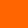 | `--primary` | `#ff6600` | رنگ اصلی قالب (از قبل تعریف شده بود، دست نخورده) |
| 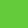 | `--secondary` | `#64cc3a` | رنگ دوم |
| 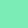 | `--third` | `#7becb6` | رنگ سوم |
| 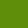 | `--fourth` | `#5f8e09` | رنگ چهارم |
| 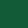 | `--fifth` | `#125b37` | رنگ پنجم |
|  | `--bg` | `#1a1a1a` | بک‌گراند اصلی سایت و پرده Braze |
|  | `--bg_soft` | `#242424` | بک‌گراند کمی روشن‌تر |
| 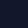 | `--bg_dark` | `#13172b` | بک‌گراند تیره کمکی |
|  | `--bg_gray` | `#e1e1e1` | خاکستری کمکی قالب |
| 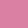 | `--hover` | `#da80a3` | رنگ هاور |
|  | `--text` | `#ffffff` | رنگ متن روی تم تیره |
| 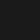 | `--text_dark` | `#1a1a1a` | رنگ متن روی زمینه روشن |
| 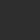 | `--glass` | `rgba(255,255,255,.06)` | بک‌گراند شیشه‌ای منو و اطلاعات تماس فوتر |
| | `--glass_strong` | `rgba(255,255,255,.1)` | بک‌گراند شیشه‌ای پررنگ‌تر (کادرها و هاور) |
| | `--glass_border` | `rgba(255,255,255,.12)` | بوردر عناصر شیشه‌ای |
|  | `--cover` | `rgba(0,0,0,.55)` | کاور مشکی روی تصاویر |
| 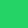 / 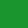 | `--green1` / `--green2` | `#25d366` / `#1a952e` | سبز |
|  /  /  | `--gray1` / `--gray2` / `--gray_dark` | `#f0f0f0` / `#d2d2d2` / `#616161` | خاکستری‌ها |
| 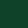 | `--footer` | `#0f4229` | بک‌گراند فوتر |
| | `--radius1` | `10px` | بوردر رِیدیوس استاندارد قالب — همه جا از همین متغیر استفاده شده |
| | `--radius2` | `20px` | بوردر رِیدیوس دوم |

### تغییرهایی که روی `style.css` قبلی داده شد

- `--radius1` از `32px` به `10px` تغییر کرد (طبق درخواست).
- `--bg` از `#f1f1f1` به `#1a1a1a` تغییر کرد (تم کلی مشکی).
- `--text` از `#000000` به `#ffffff` تغییر کرد، چون متن مشکی روی تم تیره خوانا نبود.
- در `h1..h6` مقدار `color: initial` به `color: inherit` عوض شد (با `initial` تیتر‌ها روی تم تیره مشکی می‌شدند).
- `font-weight` پیش‌فرض بدنه و تیترها `500` است (نه `700`).
- `overflow-x: hidden` از `body` برداشته شد (روی `html` هست و کافی است). با وجود آن روی
  `body`، تگ `position: sticky` کار نمی‌کند و تیتر سکشن محصولات نمی‌چسبید.

## منابع — چه چیزی از کجا آمده

### سکشن ۱ — اسلایدر فول‌اسکرین

- <https://hilight.design>
  - **افکت نور موس:** استایل `div.lightBlock` مستقیم از همین سایت کپی شده
    (دایره ۳۵۹ پیکسلی سفید، `mix-blend-mode: overlay`، `filter: blur(141px)`، `opacity: .8`
    در حالت `lightBlock_active`) و موقعیتش هم مثل خودشان با
    `transform: matrix(1,0,0,1,X,Y)` روی حرکت موس ست می‌شود.
    تفاوت: اینجا به‌جای `position: fixed` داخل خود سکشن (`.lightArea`) است تا نور از سکشن بیرون نزند.
  - **نحوه عوض شدن اسلایدها:** الهام گرفته شده. در سایت مرجع عکس اول خاموش می‌شود،
    صفحه مشکی می‌شود و بعد عکس بعدی روشن می‌شود. با Swiper این کار با تایمینگ CSS انجام شده:
    عکس فعلی ۰.۸ ثانیه فید اوت می‌شود و عکس بعدی با ۰.۸ ثانیه تأخیر فید این می‌شود،
    پس بین دو عکس یک لحظه مشکی می‌افتد.
- <https://g1verify.ir>
  - **منوی شیشه‌ای:** همان ترکیب `.nav-outer` + `.nav.glass` کپی شده —
    `background: rgba(255,255,255,.06)` + `backdrop-filter: blur(18px)`، بدون بوردر،
    داخل container، با مارجین از بالا و فیکس روی اسکرول.
- <https://preview.envytheme.ir/touex/index.html>
  - **افکت باز شدن زیرمنو:** عیناً کپی شده —
    `transform: perspective(300px) rotateX(-18deg)` → `rotateX(0)` همراه
    `opacity`/`visibility` با `transition: all .25s ease-in-out`.
    زیرمنوی لایه سه هم مثل خودشان با `right: 100%` از کنار باز می‌شود.
- <https://template.dsngrid.com/exart/index.html>
  - **هاور لینک‌های زیرمنو:** از `.primary-nav > li ul li:before` کپی شده —
    یک نوار ۱ پیکسلی که با `height: 0` → `height: 100%` باز می‌شود.
    چون قالب راست‌چین است نوار روی `right: 0` گذاشته شده.

### اسکرول نرم کل صفحه

- <https://uithemez.com/i/Vexium/home-main.html> و <https://uithemez.com/i/Lumna/home-main.html>
  - کل صفحه داخل `#smooth-wrapper` > `#smooth-content` است. همان
    `ScrollSmoother.create({ smooth: 2, effects: true })` از `smoother-script.js`
    آن قالب‌ها. `data-speed="0.5"` روی عکس محصولات و مشاوره همان افکت پارالاکس نرم است.

### سکشن ۲ — Braze

- <https://uithemez.com/i/Vexium/home-main.html>
  - کانواس dissolve داخل خود هیرو است (مثل `.hero-canvas`)، هیرو `120vh` است و
    تیتر سفید Braze پایین هیرو می‌نشیند تا از اول نصفش معلوم باشد.
    شیدر همان `Hash` / `noise` / `fbm` است، رنگ `#e1e1e1` و `spread: 0.5` و
    فرمول اسکرول `(scroll / (heroH - viewport)) * 0.3` عیناً از `script-hero1.js`.
    بدون اسکرول پرده شفاف است؛ با اولین اسکرول لبهٔ نویزی خاکستری شروع می‌شود.
    بین هیرو و سه کارت فاصلهٔ اضافه (سکشن خالی) نیست.

### سکشن ۳ — معرفی و چشم‌انداز و گواهینامه‌ها

- <https://uithemez.com/i/Vexium/home-main.html> (قسمت `brand vision`)
  - **باز شدن سه کادر با اسکرول:** از `.services-style1 .service-card` کپی شده.
    کادر کناری‌ها با `translateX(±100%) rotate(±2deg)` روی هم جمع‌اند و با اسکرول باز می‌شوند
    (در سایت مرجع با GSAP ScrollTrigger و `scrub`، اینجا با یک حلقه `requestAnimationFrame`).
    تیترهای `03` / `our services` / `brand vision` و شماره بالای کادرها حذف شده‌اند و
    بک‌گراند سفید یک‌تکه کادرها با شیشه‌ای + blur عوض شده.
- <https://uithemez.com/i/Lumna/home-main.html>
  - **افکت عکس‌های گواهینامه:** از `.bg-img` با `data-speed` کپی شده — عکس بلندتر از
    کادرش است و داخل کادر `overflow: hidden` با اسکرول بالا پایین می‌رود.
- <https://codepen.io/chancesq/pen/qBOyQoW>
  - **دکمه اصلی قالب (`.btnFramed`):** فقط تیک‌های ۱ پیکسلی گوشه، بدون بک‌گراند
    سفید یا مشکی. هشت `linear-gradient` روی `--btn-frame` (با `@property`) از ۱۴
    پیکسل به `50% + 1px` انیمیت می‌شوند تا بوردر کامل شود. همین کلاس در همه جای
    سایت (کارت‌ها، محصولات، مشاوره، بلاگ) استفاده شده است.

### سکشن ۴ — نوار متحرک

- <https://uithemez.com/i/Lumna/home-main.html>
  - از `.main-marq` / `.slide-har` کپی شده: دو باکس یکسان پشت هم با انیمیشن
    `translateX(0) → translateX(-100%)` در ۷۰ ثانیه، و کاور دو طرف با
    `linear-gradient` ۲۵۰ پیکسلی. تفاوت: متن‌های outline/stroke حذف شده و همه تیترها سفید توپر هستند.

### سکشن ۵ — جدیدترین محصولات

- <https://uithemez.com/i/Lumna/home-main.html> (قسمت `featured projects`)
  - چیدمان کپی شده ولی آینه شده: تیتر سمت راست (`position: sticky`) و تصاویر سمت چپ.
    پارالاکس: کادر ۵۰۰ پیکسل با عکس مربعی ۸۵۰ پیکسل و `data-speed="0.5"` از
    ScrollSmoother (عکس‌های مربع Lumna `works/1/1.jpg` و `1/2.jpg`).
    هاور عکس: کادر کپسولی «باتری یو پی اس»؛ بک‌گراند هاور `--third`.
    عنوان محصول `h2` لینک است؛ هاور رنگ `--primary` از راست روی متن می‌آید.

### سکشن ۶ — مشاوره پیش از خرید

- <https://uithemez.com/i/Vexium/home-main.html>
  - **سکشن پارالاکس:** همان ساختار `bg-img background-position-center h-800px` داخل یک
    کادر ۶۰۰ پیکسلی با `overflow: hidden`.
  - **ریویل تیتر:** از همان افکتی که روی متن
    «Our design studio specializes in creating modern, clean, and effective designs…»
    هست کپی شده — متن به کلمه شکسته می‌شود و هر کلمه با اسکرول از `opacity: .2` به `1` می‌رسد.
  - کاور مشکی و افکت نور موس همان چیزی است که روی اسلایدر سکشن اول استفاده شده.

### سکشن ۷ — اخبار و مقالات

- <https://uithemez.com/i/Lumna/home-main.html> (قسمت `Learn our recent journal`)
  - سه پست در یک ردیف. هاور عکس همان افکت displacement/glitch کتابخانه
    `hover-effect` است: دو عکس روی هم + `img/heightMap.png`، `dispFactor` از ۰ به ۱
    با easing `expo.out` (۱.۶ ثانیه ورود / ۱.۲ ثانیه خروج). بدون Three.js و GSAP،
    شیدر با WebGL خالص اجرا می‌شود. زوم ساده استفاده نشده.
  - تیتر «اخبار و مقالات» همان سایز و افکت پر شدن کلمه‌به‌کلمهٔ تیتر پارالاکس است.
  - دکمه آرشیو همان `.btnFramed`.

### سکشن ۸ — فوتر

- راست `col-lg-4`: لوگوی سفید + توضیح، بک‌گراند عکس غرفه (`img/footer-booth.jpg`)
  و **دو** نوار برق.
- چپ `col-lg-8`: «دسترسی سریع» + لینک‌ها، اطلاعات تماس داخل کادر شیشه‌ای،
  بک‌گراند عکس جرقه (`img/footer-spark.jpg`) و **سه** نوار برق.
- نوار برق از <https://pooyanbattery.ir> کپی شده: `div.lines` > `div.line` با
  `::after` و انیمیشن `run` هفت‌ثانیه‌ای (`cubic-bezier(.4, .26, 0, .97)`).
- شبکه‌های اجتماعی: اینستاگرام با برچسب متنی، تلگرام، واتساپ، X.
- کپی‌رایت سمت راست، «طراحی سایت : پرشین تیک» زیر آن، شبکه‌های اجتماعی سمت چپ.
  لینک پرشین تیک: <https://persiantik.net>. متن فوتر `15px` / `font-weight: 400`.

اعداد صفحه (تلفن، آدرس، آمپر محصولات) داخل `.ss02` هستند تا با stylistic set فونت ایران‌یکان فارسی شوند.

### صفحه فروشگاه و تماس

- <https://uithemez.com/i/Lumna/home-main.html>
  - **پنج عکس بالای فروشگاه:** همان `hover-this` / `hover-anim` با جابه‌جایی `move = 100` روی حرکت موس.
  - **هاور عکس داخل `.wp-caption`:** همان displacement/glitch سکشن اخبار (`hover-effect` + `img/heightMap.png`).
- <https://pooyanbattery.ir>
  - متن مقالهٔ صفحه فروشگاه از همین سایت برداشته شده.
- <https://tympanus.net/codrops/2014/04/23/how-to-create-a-glitch-effect-with-css/>
  - **هاور لینک داخل `.post_single` (`.link--helike`):** افکت glitch متن و خط، از آموزش Lucas Bebber در Codrops.
    دمو: <https://tympanus.net/Tutorials/CSSGlitchEffect/>
- <https://github.com/woodroots/infiniteslidev2>
  - **نوار لوگوی مشتریان:** همان infiniteslide v2، در `js/infiniteslide.js` بدون jQuery
    (پلاگین اصلی `$.fn.infiniteslide` است و اینجا بازنویسی شده).
    بچه‌ها کلون می‌شوند، فاصله تا اولین کلون اندازه گرفته می‌شود، و همان فاصله
    با گام پیکسل کامل روی تیک GSAP جلو می‌رود تا ری‌استارت keyframe پرش ۱px نسازد.
    سرعت ۸۰ پیکسل در ثانیه.
- فوتر `footer.siteFooter` در صفحهٔ اصلی، فروشگاه و تماس یکی است.

## کارهای باقی‌مانده

- **لوگو:** `img/logo1.png` متن تیره دارد و روی هدر تیره دیده نمی‌شد، پس یک نسخه روشن
  (`img/logo1-light.png`) از آن ساخته شد. اگر نسخه رسمی لوگوی سفید را داشتید، همین فایل را عوض کنید.
- **جای لوگو:** طبق توضیح، لوگو سمت چپ و آیکون‌ها سمت راست منو هستند. اگر خواستید برعکس شود،
  فقط `order` در `.navLogo` و `.navTools` را در `css/style.css` جابه‌جا کنید.
- ریسپانسیو (موبایل و تبلت).
